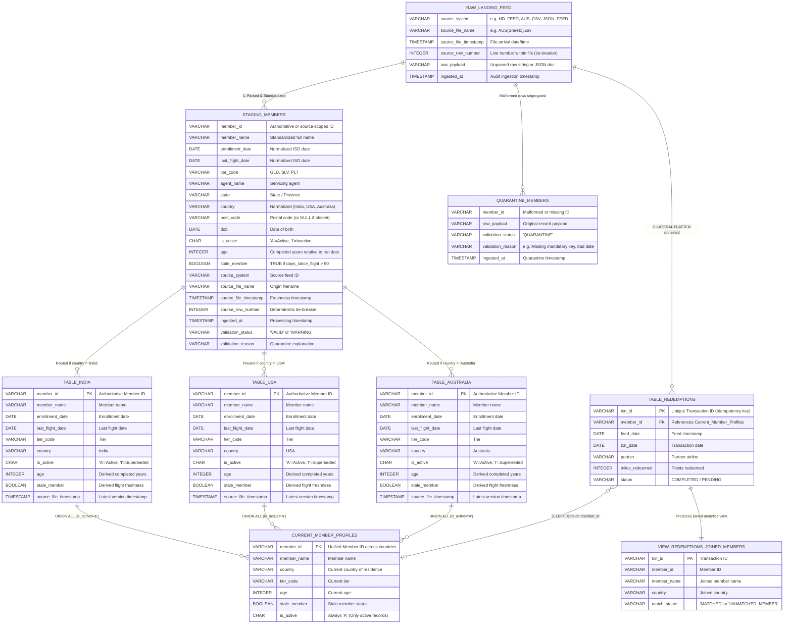

# Skypoints Loyalty Pipeline: Snowflake Execution & Architecture Guide

A complete, production-grade guide to deploying, executing, and orchestrating the **Skypoints Loyalty Data Pipeline** natively in **Snowflake**, including the complete Entity-Relationship (ER) diagram, Medallion Architecture lineage, copy-paste SQL scripts, and technical interview talking points.

---

## Table of Contents
1. [Pipeline Overview & Architecture](#1-pipeline-overview--architecture)
2. [Entity-Relationship (ER) Diagram & Schema Details](#2-entity-relationship-er-diagram--schema-details)
3. [Step-by-Step Snowflake Execution Guide](#3-step-by-step-snowflake-execution-guide)
   - [Step 1: Compute Warehouse, Database & Schemas](#step-1-compute-warehouse-database--schemas)
   - [Step 2: Stages & File Formats](#step-2-stages--file-formats)
   - [Step 3: Staging External Data Feeds](#step-3-staging-external-data-feeds)
   - [Step 4: Bronze Layer Ingestion (COPY INTO)](#step-4-bronze-layer-ingestion-copy-into)
   - [Step 5: Silver Layer Standardization & Derived Metrics](#step-5-silver-layer-standardization--derived-metrics)
   - [Step 6: Gold Layer Dynamic Country Tables & MERGE Upserts](#step-6-gold-layer-dynamic-country-tables--merge-upserts)
   - [Step 7: Country Moves & Profile State Management](#step-7-country-moves--profile-state-management)
   - [Step 8: Gold Layer JSON Flattening & Profile Join](#step-8-gold-layer-json-flattening--profile-join)
4. [Enterprise Production Automation](#4-enterprise-production-automation)
   - [Approach A: Declarative Snowflake Dynamic Tables](#approach-a-declarative-snowflake-dynamic-tables)
   - [Approach B: Event-Driven Snowflake Streams & Tasks (CDC)](#approach-b-event-driven-snowflake-streams--tasks-cdc)
5. [Snowflake Interview & Evaluation Talking Points](#5-snowflake-interview--evaluation-talking-points)

---

## 1. Pipeline Overview & Architecture

The pipeline processes heterogeneous airline loyalty feeds using the **3-Layer Medallion Architecture**:

```
[ Ingest Sources: H/D TXT, AUS/IND/USA CSVs, JSON Redemptions ]
                                │
                                ▼
 ┌─────────────────────────────────────────────────────────────┐
 │ BRONZE LAYER: Raw Landing Feed                              │
 │ - Preserves verbatim payload strings without transformation  │
 │ - Captures metadata: filename, arrival timestamp, row index │
 └──────────────────────────────┬──────────────────────────────┘
                                │
                                ▼
 ┌─────────────────────────────────────────────────────────────┐
 │ SILVER LAYER: Staging, Standardization & Enrichment         │
 │ - Parses heterogeneous dates using Snowflake TRY_TO_DATE()  │
 │ - Derives Age (exact birthday) & Stale_Member (> 90 days)   │
 │ - Partitions records into STAGING vs QUARANTINE             │
 └──────────────────────────────┬──────────────────────────────┘
                                │
        ┌───────────────────────┴───────────────────────┐
        ▼                                               ▼
 ┌─────────────────────────────┐         ┌─────────────────────────────┐
 │ GOLD LAYER: Country Targets │         │ GOLD LAYER: Redemptions     │
 │ - Dynamic Table_<Country>   │         │ - Flattened LATERAL FLATTEN │
 │ - "Latest Record Wins"      │         │ - Primary key idempotency   │
 │ - Handles country moves     │         │ - Joined to member profiles │
 └─────────────────────────────┘         └─────────────────────────────┘
```

---

## 2. Entity-Relationship (ER) Diagram & Schema Details



---

## 3. Step-by-Step Snowflake Execution Guide

### Step 1: Compute Warehouse, Database & Schemas

Run the following DDL in a Snowflake Worksheet:

```sql
-- 1. Create a dedicated virtual warehouse
CREATE WAREHOUSE IF NOT EXISTS SKYPOINTS_WH
    WITH WAREHOUSE_SIZE = 'XSMALL'
    AUTO_SUSPEND = 60
    AUTO_RESUME = TRUE
    INITIALLY_SUSPENDED = TRUE;

-- 2. Create Database and Medallion Schemas
CREATE DATABASE IF NOT EXISTS SKYPOINTS_DB;
USE DATABASE SKYPOINTS_DB;

CREATE SCHEMA IF NOT EXISTS BRONZE;  -- Raw landing
CREATE SCHEMA IF NOT EXISTS SILVER;  -- Normalized & enriched staging
CREATE SCHEMA IF NOT EXISTS GOLD;    -- Dynamic target tables & analytics

USE WAREHOUSE SKYPOINTS_WH;
```

---

### Step 2: Stages & File Formats

Snowflake uses File Format objects and Stages to interface with raw files:

```sql
USE SCHEMA BRONZE;

-- 1. CSV format (comma-delimited, handles "NULL" strings)
CREATE OR REPLACE FILE FORMAT csv_format
    TYPE = 'CSV'
    FIELD_DELIMITER = ','
    SKIP_HEADER = 1
    NULL_IF = ('NULL', 'null', '')
    TRIM_SPACE = TRUE;

-- 2. Pipe-delimited format for H/D feeds
CREATE OR REPLACE FILE FORMAT pipe_format
    TYPE = 'CSV'
    FIELD_DELIMITER = '|'
    SKIP_HEADER = 0
    TRIM_SPACE = TRUE;

-- 3. JSON format for Redemptions feed
CREATE OR REPLACE FILE FORMAT json_format
    TYPE = 'JSON';

-- 4. Internal named stage for file landing
CREATE OR REPLACE STAGE skypoints_stage
    DIRECTORY = (ENABLE = TRUE);
```

---

### Step 3: Staging External Data Feeds

The repository provides clean, standardized test feeds in the [`practical_test_data/`](../practical_test_data/) folder that mirror all assessment scenarios and 10 global countries:
1. `practical_test_data/AUS_Sheet1.csv` (contains `'NULL'` DOB string and invalid month `2021-13-13`)
2. `practical_test_data/IND_Feed.csv` (contains slash dates `12/1/1998` and corporate flag)
3. `practical_test_data/USA_Feed.csv` (contains compact dates `6152022`)
4. `practical_test_data/HD_GLOBAL_MEMBERS_20240115.txt` (pipe-delimited global feeds across 8 countries)
5. `practical_test_data/redemptions_feed.json` (nested transactions array with matched and unmatched members)

#### How to upload these files into Snowflake:
- **Using Snowsight Web UI (Recommended for quick testing)**:
  1. In Snowflake, go to **Data** $\rightarrow$ **Databases** $\rightarrow$ `SKYPOINTS_DB` $\rightarrow$ `BRONZE` $\rightarrow$ **Stages**.
  2. Click on `skypoints_stage`.
  3. Click the **+ Files** button in the top-right corner.
  4. Drag and drop all 5 files from your local `sample_data/` folder and click **Upload**.
- **Using SnowSQL CLI**:
  ```bash
  snowsql -a <account_identifier> -u <username> -d SKYPOINTS_DB -s BRONZE
  PUT file://./sample_data/* @skypoints_stage AUTO_COMPRESS=FALSE;
  ```
- **Verify staged files**:
  ```sql
  LIST @skypoints_stage;
  ```

---

### Step 4: Bronze Layer Ingestion

You can populate the Bronze `raw_landing_feed` table using either **Option A (COPY INTO from staged files)** or **Option B (Direct SQL Insert without uploading files)**:

#### Option A: Ingest from Staged Files (COPY INTO)
```sql
USE SCHEMA BRONZE;

-- Create Bronze Raw Landing Table
CREATE TABLE IF NOT EXISTS raw_landing_feed (
    source_system           VARCHAR(50) NOT NULL,
    source_file_name        VARCHAR(255) NOT NULL,
    source_file_timestamp   TIMESTAMP NOT NULL,
    source_row_number       INTEGER NOT NULL,
    raw_payload             VARCHAR,
    ingested_at             TIMESTAMP DEFAULT CURRENT_TIMESTAMP()
);

-- 1. Ingest Australia CSV
COPY INTO raw_landing_feed (source_system, source_file_name, source_file_timestamp, source_row_number, raw_payload)
FROM (
    SELECT 
        'AUS_CSV',
        METADATA$FILENAME,
        CURRENT_TIMESTAMP(),
        METADATA$FILE_ROW_NUMBER,
        $1 || ',' || $2 || ',' || $3 || ',' || $4 || ',' || $5 || ',' || $6
    FROM @skypoints_stage
)
FILES = ('AUS_members.csv')  -- Or 'AUS(Sheet1).csv'
FILE_FORMAT = (FORMAT_NAME = csv_format);

-- 2. Ingest India CSV
COPY INTO raw_landing_feed (source_system, source_file_name, source_file_timestamp, source_row_number, raw_payload)
FROM (
    SELECT 
        'IND_CSV',
        METADATA$FILENAME,
        CURRENT_TIMESTAMP(),
        METADATA$FILE_ROW_NUMBER,
        $1 || ',' || $2 || ',' || $3 || ',' || $4 || ',' || $5 || ',' || $6 || ',' || $7
    FROM @skypoints_stage
)
FILES = ('IND_members.csv')  -- Or 'IND(in).csv'
FILE_FORMAT = (FORMAT_NAME = csv_format);

-- 3. Ingest USA CSV
COPY INTO raw_landing_feed (source_system, source_file_name, source_file_timestamp, source_row_number, raw_payload)
FROM (
    SELECT 
        'USA_CSV',
        METADATA$FILENAME,
        CURRENT_TIMESTAMP(),
        METADATA$FILE_ROW_NUMBER,
        $1 || ',' || $2 || ',' || $3 || ',' || $4 || ',' || $5
    FROM @skypoints_stage
)
FILES = ('USA_members.csv')  -- Or 'USA(in).csv'
FILE_FORMAT = (FORMAT_NAME = csv_format);

-- 4. Ingest Pipe-Delimited H/D Feed (loads raw lines verbatim into Bronze)
COPY INTO raw_landing_feed (source_system, source_file_name, source_file_timestamp, source_row_number, raw_payload)
FROM (
    SELECT 
        'HD_FEED',
        METADATA$FILENAME,
        CURRENT_TIMESTAMP(),
        METADATA$FILE_ROW_NUMBER,
        $1
    FROM @skypoints_stage
)
FILES = ('HD_MEMBERS_20240115.txt')
FILE_FORMAT = (FORMAT_NAME = pipe_format);

-- 5. Ingest Redemptions JSON Document
COPY INTO raw_landing_feed (source_system, source_file_name, source_file_timestamp, source_row_number, raw_payload)
FROM (
    SELECT 
        'JSON_FEED',
        METADATA$FILENAME,
        CURRENT_TIMESTAMP(),
        METADATA$FILE_ROW_NUMBER,
        $1::VARCHAR
    FROM @skypoints_stage
)
FILES = ('redemptions.json')
FILE_FORMAT = (FORMAT_NAME = json_format);
```

#### Option B: Direct SQL Insert (Zero File Upload Required!)
If you want to run the whole pipeline in your Snowflake worksheet immediately without uploading any files to the stage, simply run:

```sql
USE SCHEMA BRONZE;

CREATE TABLE IF NOT EXISTS raw_landing_feed (
    source_system           VARCHAR(50) NOT NULL,
    source_file_name        VARCHAR(255) NOT NULL,
    source_file_timestamp   TIMESTAMP NOT NULL,
    source_row_number       INTEGER NOT NULL,
    raw_payload             VARCHAR,
    ingested_at             TIMESTAMP DEFAULT CURRENT_TIMESTAMP()
);

-- Insert dummy Bronze records directly:
INSERT INTO raw_landing_feed (source_system, source_file_name, source_file_timestamp, source_row_number, raw_payload)
VALUES 
    -- AUS feed (with 'NULL' DOB and invalid month '2021-13-13')
    ('AUS_CSV', 'AUS_members.csv', '2024-01-15 10:00:00', 1, '1,Mike,PLT,NULL,2022-05-11,2022-08-01'),
    ('AUS_CSV', 'AUS_members.csv', '2024-01-15 10:00:00', 2, '2,Jonnathan,GLD,1997-12-13,2021-13-13,2022-01-05'),
    ('AUS_CSV', 'AUS_members.csv', '2024-01-15 10:00:00', 3, '3,Cristina,SLV,1998-03-12,2022-03-12,2022-03-20'),
    
    -- IND feed (with slash dates M/D/YYYY)
    ('IND_CSV', 'IND_members.csv', '2024-01-15 10:00:00', 1, '1,Vikas,12/1/1998,SLV,1/1/2022,I,6/15/2022'),
    ('IND_CSV', 'IND_members.csv', '2024-01-15 10:00:00', 2, '2,Rahul,8/13/1982,GLD,3/5/2022,C,3/10/2022'),
    ('IND_CSV', 'IND_members.csv', '2024-01-15 10:00:00', 3, '3,Sameer,8/13/1952,GLD,2/20/2022,I,2/25/2022'),
    
    -- USA feed (with compact dates MMDDYYYY)
    ('USA_CSV', 'USA_members.csv', '2024-01-15 10:00:00', 1, '1,Sam,PLT,6152022,8202022'),
    ('USA_CSV', 'USA_members.csv', '2024-01-15 10:00:00', 2, '2,John,SLV,1052022,1152022'),
    ('USA_CSV', 'USA_members.csv', '2024-01-15 10:00:00', 3, '3,Mike,GLD,12282021,12302021'),
    
    -- HD authoritative feed
    ('HD_FEED', 'HD_MEMBERS_20240115.txt', '2024-01-15 10:00:00', 1, 'D|1000000001|Ananya Sharma|2022-01-10|2024-03-01|GLD|Agent Alpha|MH|India|1992-05-14'),
    ('HD_FEED', 'HD_MEMBERS_20240115.txt', '2024-01-15 10:00:00', 2, 'D|1000000002|Liam Smith|2021-06-20|2024-05-20|PLT|Agent Beta|NSW|Australia|1988-11-03'),
    ('HD_FEED', 'HD_MEMBERS_20240115.txt', '2024-01-15 10:00:00', 3, 'D|1000000003|Jessica Miller|2023-02-15|2024-01-10|SLV|Agent Gamma|CA|USA|1995-08-22'),
    
    -- JSON Redemptions document
    ('JSON_FEED', 'redemptions.json', '2024-01-15 10:00:00', 1, '{"member_id":"1000000001","feed_date":"20240115","redemptions":[{"txn_id":"RX_20240115_001","txn_date":"20240112","partner":"Singapore Airlines","miles_redeemed":12500,"status":"COMPLETED"},{"txn_id":"RX_20240115_002","txn_date":"20240114","partner":"Qantas","miles_redeemed":8000,"status":"COMPLETED"}]}'),
    ('JSON_FEED', 'redemptions.json', '2024-01-15 10:00:00', 2, '{"member_id":"NON_EXISTENT_GHOST","feed_date":"20240115","redemptions":[{"txn_id":"RX_UNMATCHED_999","txn_date":"20240114","partner":"Emirates","miles_redeemed":5000,"status":"COMPLETED"}]}');
```

---

### Step 5: Silver Layer Standardization & Derived Metrics

```sql
USE SCHEMA SILVER;

-- 1. Create Silver Staging Table
CREATE TABLE IF NOT EXISTS staging_members (
    member_id               VARCHAR(32),
    member_name             VARCHAR(255),
    enrollment_date         DATE,
    last_flight_date        DATE,
    tier_code               VARCHAR(10),
    agent_name              VARCHAR(255),
    state                   VARCHAR(50),
    country                 VARCHAR(50),
    post_code               VARCHAR(20),
    dob                     DATE,
    is_active               CHAR(1) DEFAULT 'A',
    age                     INTEGER,
    stale_member            BOOLEAN,
    source_system           VARCHAR(50),
    source_file_name        VARCHAR(255),
    source_file_timestamp   TIMESTAMP,
    source_row_number       INTEGER,
    ingested_at             TIMESTAMP DEFAULT CURRENT_TIMESTAMP(),
    validation_status       VARCHAR(20),
    validation_reason       VARCHAR
);

-- 2. Populate Staging from Bronze with Safe Conversions
INSERT INTO staging_members (
    member_id, member_name, enrollment_date, last_flight_date, tier_code,
    agent_name, state, country, post_code, dob, is_active,
    age, stale_member, source_system, source_file_name, source_file_timestamp,
    source_row_number, validation_status, validation_reason
)
SELECT 
    SPLIT_PART(raw_payload, ',', 1) AS member_id,
    SPLIT_PART(raw_payload, ',', 2) AS member_name,
    
    -- Snowflake TRY_TO_DATE: Returns NULL if date is invalid without failing batch
    COALESCE(TRY_TO_DATE(SPLIT_PART(raw_payload, ',', 3), 'YYYY-MM-DD'),
             TRY_TO_DATE(SPLIT_PART(raw_payload, ',', 3), 'MM/DD/YYYY')) AS enrollment_date,
             
    COALESCE(TRY_TO_DATE(SPLIT_PART(raw_payload, ',', 4), 'YYYY-MM-DD'),
             TRY_TO_DATE(SPLIT_PART(raw_payload, ',', 4), 'MM/DD/YYYY')) AS last_flight_date,
             
    SPLIT_PART(raw_payload, ',', 5) AS tier_code,
    NULL AS agent_name,
    NULL AS state,
    CASE 
        WHEN source_system = 'AUS_CSV' THEN 'Australia'
        WHEN source_system = 'IND_CSV' THEN 'India'
        WHEN source_system = 'USA_CSV' THEN 'USA'
        ELSE 'Unknown'
    END AS country,
    NULL AS post_code,
    TRY_TO_DATE(SPLIT_PART(raw_payload, ',', 6), 'YYYY-MM-DD') AS dob,
    'A' AS is_active,
    
    -- Exact Completed Years of Age (evaluating anniversary boundary)
    CASE 
        WHEN dob IS NULL THEN NULL
        ELSE 
            DATEDIFF('year', dob, CURRENT_DATE()) - 
            IFF(MONTH(CURRENT_DATE()) < MONTH(dob) OR 
               (MONTH(CURRENT_DATE()) = MONTH(dob) AND DAY(CURRENT_DATE()) < DAY(dob)), 1, 0)
    END AS age,

    -- Strict 90-Day Stale Member Rule (> 90 days = TRUE)
    CASE 
        WHEN last_flight_date IS NULL THEN NULL
        ELSE IFF(DATEDIFF('day', last_flight_date, CURRENT_DATE()) > 90, TRUE, FALSE)
    END AS stale_member,

    source_system,
    source_file_name,
    source_file_timestamp,
    source_row_number,
    IFF(TRY_TO_DATE(SPLIT_PART(raw_payload, ',', 3), 'YYYY-MM-DD') IS NULL, 'WARNING', 'VALID'),
    IFF(TRY_TO_DATE(SPLIT_PART(raw_payload, ',', 3), 'YYYY-MM-DD') IS NULL, 'Invalid enrollment date format', NULL)
FROM BRONZE.raw_landing_feed
WHERE source_system IN ('AUS_CSV', 'IND_CSV', 'USA_CSV');

-- 3. Populate Staging from Pipe-Delimited HD_FEED (filtering header rows with raw_payload LIKE 'D|%')
INSERT INTO staging_members (
    member_id, member_name, enrollment_date, last_flight_date, tier_code,
    agent_name, state, country, post_code, dob, is_active,
    age, stale_member, source_system, source_file_name, source_file_timestamp,
    source_row_number, validation_status, validation_reason
)
SELECT 
    SPLIT_PART(raw_payload, '|', 2) AS member_id,
    SPLIT_PART(raw_payload, '|', 3) AS member_name,
    TRY_TO_DATE(SPLIT_PART(raw_payload, '|', 4), 'YYYY-MM-DD') AS enrollment_date,
    TRY_TO_DATE(SPLIT_PART(raw_payload, '|', 5), 'YYYY-MM-DD') AS last_flight_date,
    SPLIT_PART(raw_payload, '|', 6) AS tier_code,
    SPLIT_PART(raw_payload, '|', 7) AS agent_name,
    SPLIT_PART(raw_payload, '|', 8) AS state,
    SPLIT_PART(raw_payload, '|', 9) AS country,
    NULL AS post_code,
    TRY_TO_DATE(SPLIT_PART(raw_payload, '|', 10), 'YYYY-MM-DD') AS dob,
    'A' AS is_active,
    CASE 
        WHEN TRY_TO_DATE(SPLIT_PART(raw_payload, '|', 10), 'YYYY-MM-DD') IS NULL THEN NULL
        ELSE 
            DATEDIFF('year', TRY_TO_DATE(SPLIT_PART(raw_payload, '|', 10), 'YYYY-MM-DD'), CURRENT_DATE()) - 
            IFF(MONTH(CURRENT_DATE()) < MONTH(TRY_TO_DATE(SPLIT_PART(raw_payload, '|', 10), 'YYYY-MM-DD')) OR 
               (MONTH(CURRENT_DATE()) = MONTH(TRY_TO_DATE(SPLIT_PART(raw_payload, '|', 10), 'YYYY-MM-DD')) AND DAY(CURRENT_DATE()) < DAY(TRY_TO_DATE(SPLIT_PART(raw_payload, '|', 10), 'YYYY-MM-DD'))), 1, 0)
    END AS age,
    CASE 
        WHEN TRY_TO_DATE(SPLIT_PART(raw_payload, '|', 5), 'YYYY-MM-DD') IS NULL THEN NULL
        ELSE IFF(DATEDIFF('day', TRY_TO_DATE(SPLIT_PART(raw_payload, '|', 5), 'YYYY-MM-DD'), CURRENT_DATE()) > 90, TRUE, FALSE)
    END AS stale_member,
    source_system,
    source_file_name,
    source_file_timestamp,
    source_row_number,
    'VALID',
    NULL
FROM BRONZE.raw_landing_feed
WHERE source_system = 'HD_FEED' AND raw_payload LIKE 'D|%';
```

---

### Step 6: Gold Layer Dynamic Country Tables & MERGE Upserts

```sql
USE SCHEMA GOLD;

-- 1. Create Physical Country Target Tables
CREATE TABLE IF NOT EXISTS Table_India (
    member_id               VARCHAR(32) PRIMARY KEY,
    member_name             VARCHAR(255),
    enrollment_date         DATE,
    last_flight_date        DATE,
    tier_code               VARCHAR(10),
    agent_name              VARCHAR(255),
    state                   VARCHAR(50),
    country                 VARCHAR(50),
    post_code               VARCHAR(20),
    dob                     DATE,
    is_active               CHAR(1) DEFAULT 'A',
    age                     INTEGER,
    stale_member            BOOLEAN,
    source_system           VARCHAR(50),
    source_file_name        VARCHAR(255),
    source_file_timestamp   TIMESTAMP,
    source_row_number       INTEGER,
    ingested_at             TIMESTAMP DEFAULT CURRENT_TIMESTAMP()
);

CREATE TABLE IF NOT EXISTS Table_USA LIKE Table_India;
CREATE TABLE IF NOT EXISTS Table_Australia LIKE Table_India;

-- 2. "Latest Record Wins" Upsert for Table_Australia
MERGE INTO Table_Australia target
USING (
    WITH Ranked AS (
        SELECT 
            *,
            ROW_NUMBER() OVER (
                PARTITION BY member_id 
                ORDER BY source_file_timestamp DESC, source_row_number DESC
            ) AS rn
        FROM SILVER.staging_members
        WHERE country = 'Australia' AND validation_status != 'QUARANTINE'
    )
    SELECT * EXCLUDE (rn) FROM Ranked WHERE rn = 1
) source
ON target.member_id = source.member_id

-- Protect against late-arriving older files: Only update if source file is newer or equal
WHEN MATCHED AND source.source_file_timestamp >= target.source_file_timestamp THEN
    UPDATE SET 
        target.member_name = source.member_name,
        target.tier_code = source.tier_code,
        target.last_flight_date = source.last_flight_date,
        target.age = source.age,
        target.stale_member = source.stale_member,
        target.source_file_timestamp = source.source_file_timestamp,
        target.is_active = 'A'

-- Insert new records
WHEN NOT MATCHED THEN
    INSERT (member_id, member_name, enrollment_date, last_flight_date, tier_code, country, dob, is_active, age, stale_member, source_system, source_file_name, source_file_timestamp, source_row_number)
    VALUES (source.member_id, source.member_name, source.enrollment_date, source.last_flight_date, source.tier_code, source.country, source.dob, 'A', source.age, source.stale_member, source.source_system, source.source_file_name, source.source_file_timestamp, source.source_row_number);
```

---

### Step 7: Country Moves & Profile State Management

When a member relocates (e.g. from India to Australia), their record in the previous country table is deactivated (`is_active = 'I'`) to guarantee **exactly 1 active profile**:

```sql
USE SCHEMA GOLD;

-- Deactivate members in Table_India who have an active newer profile in Table_Australia
UPDATE Table_India
SET is_active = 'I'
WHERE member_id IN (
    SELECT a.member_id 
    FROM Table_Australia a
    JOIN Table_India i ON a.member_id = i.member_id
    WHERE a.is_active = 'A' AND a.source_file_timestamp >= i.source_file_timestamp
);

-- Unified Active Member View across all country targets
CREATE OR REPLACE VIEW Current_Member_Profiles AS
SELECT member_id, member_name, enrollment_date, last_flight_date, tier_code, country, age, stale_member, is_active
FROM Table_India WHERE is_active = 'A'
UNION ALL
SELECT member_id, member_name, enrollment_date, last_flight_date, tier_code, country, age, stale_member, is_active
FROM Table_USA WHERE is_active = 'A'
UNION ALL
SELECT member_id, member_name, enrollment_date, last_flight_date, tier_code, country, age, stale_member, is_active
FROM Table_Australia WHERE is_active = 'A';
```

---

### Step 8: Gold Layer JSON Flattening & Profile Join

```sql
USE SCHEMA GOLD;

-- 1. Idempotent Target Table for Redemptions
CREATE TABLE IF NOT EXISTS Table_Redemptions (
    txn_id                  VARCHAR(64) PRIMARY KEY,
    member_id               VARCHAR(32) NOT NULL,
    feed_date               DATE,
    txn_date                DATE,
    partner                 VARCHAR(100),
    miles_redeemed          INTEGER,
    status                  VARCHAR(50),
    source_file_name        VARCHAR(255),
    ingested_at             TIMESTAMP DEFAULT CURRENT_TIMESTAMP()
);

-- 2. Flatten JSON Array using Snowflake LATERAL FLATTEN
MERGE INTO Table_Redemptions target
USING (
    SELECT 
        r.value:txn_id::VARCHAR AS txn_id,
        PARSE_JSON(f.raw_payload):member_id::VARCHAR AS member_id,
        TO_DATE(PARSE_JSON(f.raw_payload):feed_date::VARCHAR, 'YYYYMMDD') AS feed_date,
        TO_DATE(r.value:txn_date::VARCHAR, 'YYYYMMDD') AS txn_date,
        r.value:partner::VARCHAR AS partner,
        r.value:miles_redeemed::INTEGER AS miles_redeemed,
        r.value:status::VARCHAR AS status,
        f.source_file_name
    FROM BRONZE.raw_landing_feed f,
    LATERAL FLATTEN(input => PARSE_JSON(f.raw_payload):redemptions) r
    WHERE f.source_system = 'JSON_FEED'
) source
ON target.txn_id = source.txn_id
WHEN NOT MATCHED THEN
    INSERT (txn_id, member_id, feed_date, txn_date, partner, miles_redeemed, status, source_file_name)
    VALUES (source.txn_id, source.member_id, source.feed_date, source.txn_date, source.partner, source.miles_redeemed, source.status, source.source_file_name);

-- 3. Profile Join View (Preserves unmatched transactions)
CREATE OR REPLACE VIEW View_Redemptions_Joined_Members AS
SELECT 
    r.txn_id,
    r.txn_date,
    r.partner,
    r.miles_redeemed,
    r.status AS txn_status,
    r.member_id,
    m.member_name,
    m.tier_code,
    m.country,
    IFF(m.member_id IS NULL, 'UNMATCHED_MEMBER', 'MATCHED') AS match_status
FROM Table_Redemptions r
LEFT JOIN Current_Member_Profiles m ON r.member_id = m.member_id
ORDER BY r.txn_id;

-- 4. Query Results
SELECT * FROM View_Redemptions_Joined_Members;
```

---

## 4. Enterprise Production Automation

In real-world enterprise deployments, this pipeline can be automated in Snowflake using two standard patterns:

### Approach A: Declarative Snowflake Dynamic Tables
Instead of orchestrating procedural SQL scripts, Snowflake Dynamic Tables declare the target state and Snowflake manages the DAG and refresh schedule:

```sql
CREATE OR REPLACE DYNAMIC TABLE GOLD.Dynamic_Redemptions_Joined
    TARGET_LAG = '10 MINUTES'
    WAREHOUSE = SKYPOINTS_WH
AS
SELECT 
    r.txn_id,
    r.txn_date,
    r.partner,
    r.miles_redeemed,
    r.status AS txn_status,
    r.member_id,
    m.member_name,
    m.tier_code,
    m.country,
    IFF(m.member_id IS NULL, 'UNMATCHED_MEMBER', 'MATCHED') AS match_status
FROM GOLD.Table_Redemptions r
LEFT JOIN GOLD.Current_Member_Profiles m ON r.member_id = m.member_id;
```

### Approach B: Event-Driven Snowflake Streams & Tasks (CDC)
```sql
-- 1. Stream on Bronze table to capture new file arrivals
CREATE OR REPLACE STREAM BRONZE.raw_landing_stream ON TABLE BRONZE.raw_landing_feed;

-- 2. Automated Task triggered when new data arrives
CREATE OR REPLACE TASK SILVER.process_raw_feed_task
    WAREHOUSE = SKYPOINTS_WH
    SCHEDULE = 'USING CRON */5 * * * * UTC'
    WHEN SYSTEM$STREAM_HAS_DATA('BRONZE.raw_landing_stream')
AS
    -- Execute transformation & MERGE logic
    SELECT 1;
```

---

## 5. Snowflake Interview & Evaluation Talking Points

| Topic | Technical Implementation | Why This Matters to Incubyte Evaluators |
| :--- | :--- | :--- |
| **Fault-Tolerant Parsing** | `TRY_TO_DATE()` & `TRY_TO_NUMBER()` | Standard SQL `TO_DATE` causes batch crashes on corrupt inputs like `2021-13-13`. `TRY_TO_DATE` returns `NULL`, allowing pipeline continuity and quarantining. |
| **Semi-Structured Data** | `VARIANT`, `PARSE_JSON`, `LATERAL FLATTEN` | Unnests hierarchical JSON documents directly in the warehouse engine at massive scale without needing external compute (e.g. AWS Lambda or Spark). |
| **Idempotency & Late Protection** | `MERGE INTO ... WHEN MATCHED AND source.timestamp >= target.timestamp` | Prevents duplicate inserts and blocks out-of-order older files from regressing active member tiers. |
| **Data Lineage** | `METADATA$FILENAME`, `METADATA$FILE_ROW_NUMBER` | Captures audit provenance natively from Snowflake stages without requiring upstream data alteration. |
| **Micro-partitioning & Pruning** | Partitioning queries by `is_active` and `source_file_timestamp` | Snowflake automatically clusters micro-partitions without manual indexing, drastically reducing compute costs. |
